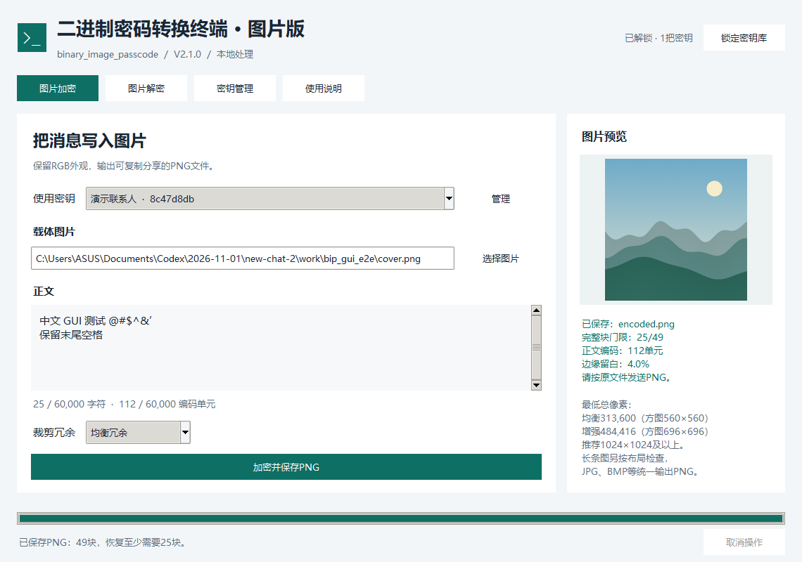
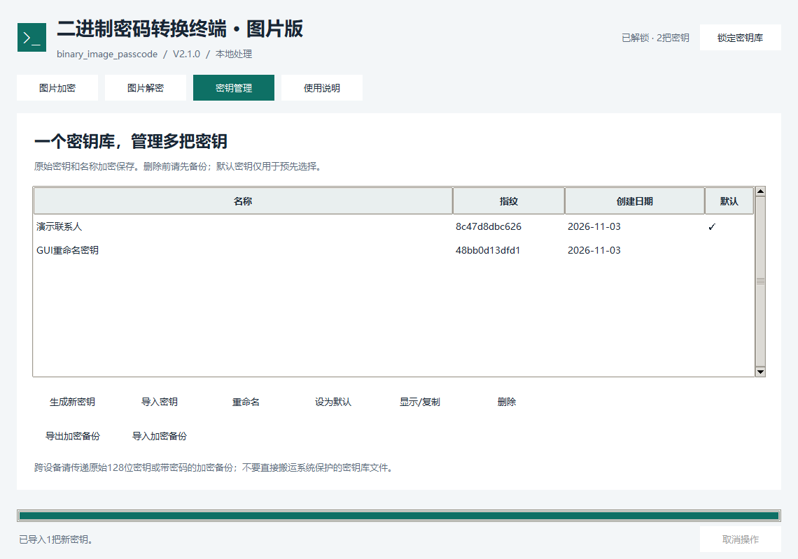

# binary_image_passcode

**二进制密码转换终端 · 图片版 V2.1.0**。Python桌面程序，支持Windows与Linux；Windows另提供无需安装Python的GUI EXE。

保留V1.1的五位字符编码和六单元BMP转义，正文容量为300,000比特。RGB三个通道独立承载不同数据：各通道最低位奇数为1、偶数为0，不再多数表决。保留消息认证、块内纠错、分布式数据块和抗裁剪恢复；可读取V2.0旧图，密钥库保持兼容。



## 运行

### Windows

直接双击 `binary_image_passcode.exe`。该文件为Windows 10/11 x64版，不需要Python；首次启动会选择本地密钥库保护方式。

从源码运行需要Python 3.11或以上，可双击 `run_windows.bat`：脚本优先启动EXE；没有EXE时建立虚拟环境并安装运行依赖。也可手动执行：

```powershell
python -m pip install -r requirements.txt
python binary_image_passcode.py
```

### Linux

需要Python 3.11或以上、Tk和可用的图形桌面。Debian/Ubuntu可先安装系统组件：

```sh
sudo apt install python3-tk python3-venv libsecret-tools
bash run_linux.sh
```

`run_linux.sh`在项目内建立`.venv`并安装依赖。`libsecret-tools`只用于系统密钥环保护；没有桌面密钥环时，可在程序中选择**主密码保护**。主密码方式不依赖Secret Service。

首次安装依赖需要联网。之后加解密和密钥管理都在本地运行，不联网、不上传图片或正文。

## 使用流程

1. 在“密钥管理”生成或导入128位数字密钥，为不同联系人分别命名。原V1.1密钥可以手动导入，前导零不可删除。
2. 在“图片加密”选择密钥、载体图片和正文，选择冗余强度，保存为另一个PNG文件。
3. 按原文件传递PNG，避免截图、缩放、滤镜和JPEG转换。
4. 接收者选择同一把密钥，在“图片解密”载入图片。程序先定位、纠错和认证，验证通过才显示正文及生成时间。

支持BMP内的Unicode标量值，排除代理码点；基础87个字符继续使用短编码，其余字符各占6单元。不支持补充平面字符，例如部分emoji。最多60,000字符，同时不能超过60,000编码单元。全部使用六单元转义时最多10,000字符。

正文区固定300,000比特，短消息也会补齐。因此一句话和较长消息的基本载荷相同。公开随机编号同步扩为384比特，掩码和位置分配随之更新；共享密钥仍为128位数字，随机编号并不增加秘密密钥的强度。加密的长度元数据用于准确恢复原始末尾空格。

时间直接使用UTC 1970-01-01 00:00:00起的整数Unix秒数，加密数值范围为0—9,999,999,999，相当于10位十进制长度，覆盖约316年。二进制中以5字节容纳该数值；不引入毫秒。解密界面只显示精确到秒的北京时间，不显示时间戳。可用范围的终点为UTC 2286-11-20 17:46:39（北京时间2286-11-21 01:46:39）。V2.0旧图仍按原分钟精度读取并标注。

## 抗裁剪：支持的具体范围

每张图按宽高和形状划分分布式128×128数据块。约100万像素以内四边留白4%，像素量每翻倍增加约2个百分点，最高12%；约400万像素留白8%，约1600万像素及以上留白12%。大图因此留有更宽的边缘裁剪缓冲。每块内部有三个类似二维码的定位图样，仅写入R通道最低位，G/B仍作为独立数据通道。

识别不依赖原始图片尺寸及整图坐标；图片裁掉一部分后，剩余完整小块仍能被独立找到。外层使用擦除纠错，保留任意足够多的有效块即可恢复完整消息。

- **均衡冗余**：通常需要保留约一半有效块。
- **增强抗裁剪**：通常需要保留约三分之一有效块，但嵌入更多像素。

实际门限会显示在界面中。**剩余图片面积比例不等于有效块比例**：一个被切断、定位点损坏或认证失败的块可能不能参与恢复。程序不承诺任意裁剪都能恢复。

已实测1024×1024均衡图片从四边各裁掉约10%或15%后恢复；裁至右下768×768后恢复；增强模式仅保留右侧512×1024后恢复。90°、180°、270°无插值旋转可恢复。相关边界及反例见[测试报告](docs/TEST_REPORT.md)。

缩放、任意角度旋转、镜像、截图、JPEG转换和颜色重映射不在保证范围内。PNG重新无损压缩但保留像素值时可恢复。

**最低要求**：均衡模式至少313,600总像素（方图参考560×560）；增强模式至少484,416总像素（方图参考696×696）；短边至少140像素，并须能排下足够完整块。低于下限会报错；总面积足够的细长图也可能因布局不足被拒绝。**最低推荐尺寸为1024×1024**，高清大图建议优先使用。上限为8,000万像素、单边20,000像素，分条定位减少大图内存峰值。解密裁剪图不强制套用加密载体的最低面积。

PNG、JPG/JPEG、BMP、静态WebP和TIFF等均可作为载体，自动转换为8位RGB并统一输出PNG。透明度铺白底，动画图像被拒绝；原始输入不被覆盖。单个输入文件另有150MiB大小限制。

## 密钥管理



支持多把密钥的生成、导入、重命名、默认选择、显示/复制、删除和加密备份；最多256把。名称和原始密钥一起加密保存，不使用明文JSON存储。

| 保护方式 | 工作方式 |
|---|---|
| Windows系统保护 | DPAPI保护随机库主密钥，再由AES-GCM保护全部记录 |
| Linux系统保护 | Secret Service保存随机库主密钥，AES-GCM保护全部记录 |
| 主密码保护 | Scrypt派生库主密钥，AES-GCM保护全部记录，跨平台可用 |

默认存储位置：

- Windows：`%LOCALAPPDATA%/BinaryImagePasscode/vault.bipvault`
- Linux：`$XDG_DATA_HOME/binary_image_passcode/vault.bipvault`，未配置XDG时为`~/.local/share/binary_image_passcode/vault.bipvault`。

新图片程序不读取、不删除原V1.1的密钥文件。已有通信密钥由用户主动导入。

导出的`.bipkeys`备份另用至少12字符的备份密码加密，支持跨设备、跨系统导入。重复密钥被跳过，同名的不同密钥自动重命名，不覆盖已有密钥。请单独保管密码，密码遗失无法恢复。

保存使用原子替换；检测并发修改，避免另一个窗口静默覆盖新记录。Linux文件权限限制为仅当前用户读写。锁定密钥库可阻止后续访问，但Python不能保证彻底擦除进程内存。删除密钥前请先备份。

## 验证、检错与限制

每个数据块有128比特HMAC认证，完整消息有256比特HMAC认证；替代原来的公开模97校验。时间、随机编号、格式和正文均受到消息认证保护。没有密钥的人不能仅重新计算公开校验码来伪造合法修改。

恢复顺序为：RGB独立通道提取 → 块内RS纠错 → 数据块认证 → 外层擦除恢复 → 完整消息认证 → 时间及正文解密。认证失败不显示候选明文。可修复的像素改动被纠错消除后，原始消息仍可通过认证；这不代表图片从未被编辑。

程序使用自定义传输及掩码组合，尚未经过独立密码学审查。像素变化通常很小，但奇偶统计和定位图样可以被分析；不承诺不可检测、平台放行、匿名通信、前向保密或重放防护。

## 示例与命令行

`examples/`提供V2.1原图、编码PNG、裁剪PNG和公开演示密钥；`examples/v20/`保留原V2.0兼容样例，按其中README即可试用。演示密钥不能用于真实消息。

Python命令行支持容量分析和批处理，密钥只通过本地密钥库访问，不把原始密钥放在命令行参数中：

```sh
python binary_image_passcode.py capacity cover.png
python binary_image_passcode.py encode cover.png --output encoded.png --text-file message.txt --key 联系人名称
python binary_image_passcode.py decode encoded.png --output recovered.txt --key 联系人名称
```

覆盖已存在输出文件需要`--force`；输出图片不能覆盖原始载体。Windows无控制台EXE用于GUI，命令行请使用Python入口。

## 扩展与开发

详见[协议与架构](docs/ARCHITECTURE.md)。编码、加密封装、擦除纠错、图像传输、密钥库和GUI分层实现，图像层可在不改密钥管理的情况下增加新定位或抗压缩方案。协议有版本、字符编码ID和传输配置ID，未知版本明确拒绝；不应在同一个配置ID下悄悄改变线格式。

```sh
python -m pip install -r requirements-dev.txt
python -m pytest tests -q
```

默认测试55项，另有2项高清集成测试可选择启用。Linux使用`BIP_RUN_LARGE=1 python -m pytest tests -q`；PowerShell先设置`$env:BIP_RUN_LARGE='1'`再运行测试。完整57项测试包含2400万和4800万像素的真实数组嵌入及裁剪恢复。

可选Windows打包：安装PyInstaller后执行`python build_windows.py`。Linux直接运行源码；Windows EXE不能作为Linux原生程序使用。

Windows GUI和DPAPI存储已实测。Linux系统密钥环分支通过模拟测试，主密码库及协议是跨平台实现；尚未在真实Linux桌面环境实测。
