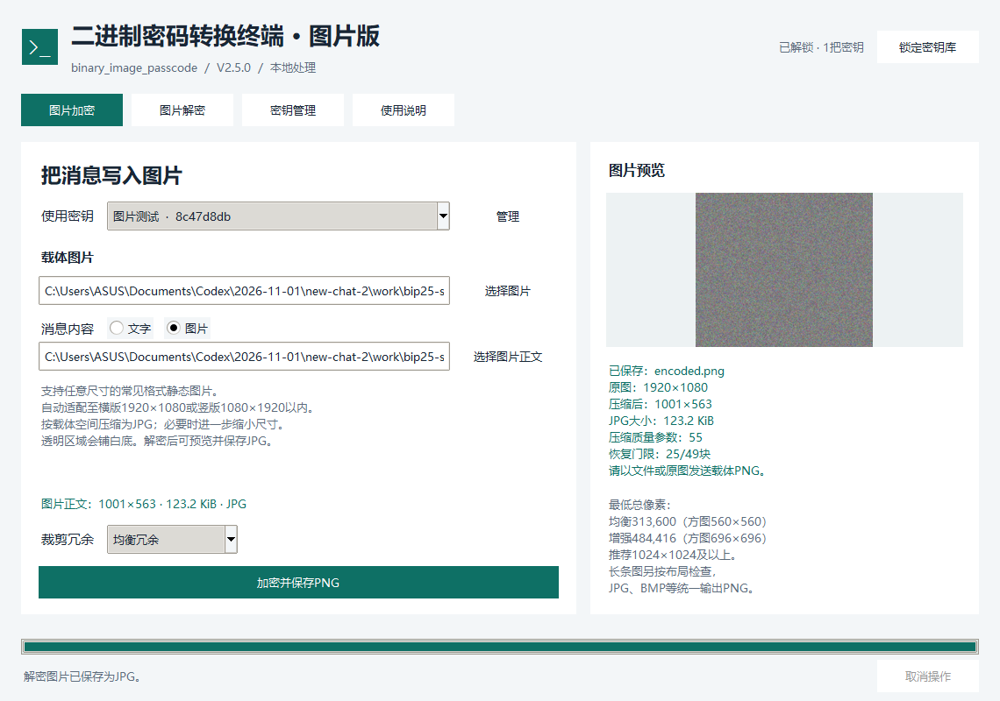
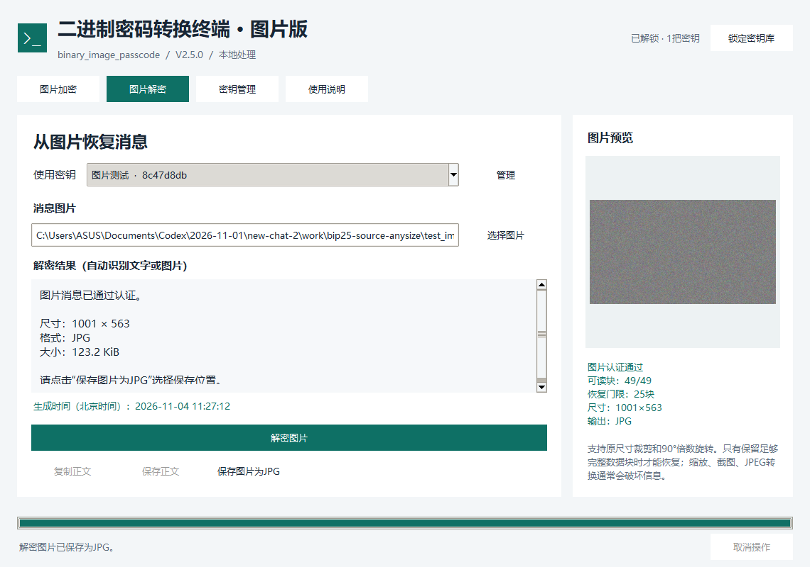

# 二进制密码转换终端 · 图片版 V2.5

Windows桌面版，支持将**文字或图片**加密藏入一张载体图片。双方使用相同的128位数字密钥；解密后可读取文字，或预览并保存JPG图片。两种消息均显示精确到秒的北京时间。

## 启动与密钥

解压发布包，双击 `binary_image_passcode.exe`，无需安装Python。首次启动选择密钥库保护方式，在“密钥管理”生成或导入128位数字密钥，保留全部前导零。

密钥库支持生成、导入、重命名、默认选择、复制、删除、锁定及加密备份。发送者和接收者须持有同一把通信密钥。V2.1桌面密钥库可继续使用，不需要重新生成密钥；请提前导出备份并妥善保管备份密码。

## 加密文字

1. 打开“图片加密”，选择密钥和**载体图片**。
2. 在“消息内容”选择“文字”，输入正文。
3. 选择均衡或增强裁剪冗余，点击“加密并保存PNG”。

文字最多60,000个编码单元；中文等扩展字符各占6单元。原始换行和末尾空格保留。支持基本多文种平面中的非代理字符，暂不支持部分表情和罕见字。

## 加密图片

1. 打开“图片加密”，选择密钥和**载体图片**。
2. 在“消息内容”选择“图片”，点击“选择图片正文”。两张图片可以不同：载体是对方直接看到的图片，图片正文是需要隐藏的内容。
3. 点击“加密并保存PNG”。完成后会显示原始尺寸、压缩后尺寸、JPG大小和恢复门限。

待加密图片不设原始分辨率或单边尺寸上限，可选择PNG、JPG、BMP、WebP、TIFF等Pillow支持的静态格式；实际读取仍受设备内存、格式解码能力和150MiB文件大小限制。透明区域铺白底，按图片方向适配到横版 **1920×1080** 或竖版 **1080×1920** 以内，保持长宽比，不放大小图。

程序将图片正文编码为JPG，根据载体空间自动降低JPEG质量；仍不能放入时，会进一步缩小尺寸。JPEG压缩有损，复杂照片、噪点多的图和较小载体可能需要明显缩小。原始图片不会被改写。**较大的载体有助于保留更多细节；建议图片消息优先选择1536×1536、2048×2048或更大的载体。**

秘密图片统一为JPG；承载加密消息的外层图片仍必须保存为PNG。不能把生成的载体PNG转成JPG发送。



## 解密与保存

1. 打开“图片解密”，选择对应密钥及收到的原始载体PNG。
2. 点击“解密图片”，程序自动识别文字或图片消息，并先验证完整性。
3. 文字结果可复制或保存为UTF-8文本；图片结果会显示预览，点击“保存图片为JPG”另存。

图片保存直接写出已验证的JPEG数据，不会在解密时再进行一次JPEG压缩。保存位置不能覆盖输入的消息图片。换图、换密钥、开始新解密或锁定密钥库时，旧图片结果会清空。

生成时间取自发送设备系统时钟，按北京时间显示到秒；不显示数值时间戳。



## 载体与传递要求

两种消息都保留RGB三通道独立嵌入、块内纠错、分布式定位和裁剪恢复。均衡模式需要约一半有效块，增强模式需要约三分之一有效块；具体门限以界面为准。块保留比例不等于图片面积保留比例。

- 均衡最低313,600像素，方图参考560×560。
- 增强最低484,416像素，方图参考696×696。
- 短边至少140像素，长宽比另需满足完整块布局。
- 推荐文字载体1024×1024及以上，图片消息使用更大载体以保留画质。
- 载体最高8,000万像素、单边20,000像素、文件150MiB；实际能处理的尺寸受内存限制。

以**文件或原图**传递生成的PNG。无损重新压缩且像素不变可以读取；有限裁剪及90°倍数无插值旋转可恢复。缩放、截图、滤镜、JPEG转换和过度裁剪可能破坏消息。

## 兼容与常见问题

- V2.5可以读取已有V2.1和V2.0文字消息；新文字消息继续使用V2.1格式。
- 新增图片消息需要V2.5接收端；此前的桌面端及安卓首发版不能读取这种图片正文。
- 显示“无法验证消息”：确认密钥一致、PNG为原文件，且未被修改或过度处理。
- 显示“可读数据块不足”：请获取更完整的载体图片。
- 图片正文变小或模糊：这是容量适配结果，可改用更大的载体或均衡冗余重新加密。
- 动画、多页图片请先导出单张静态图片；不支持的格式请转换后再选。

## 源码运行与开发

需要Python 3.11以上及Tk：

```powershell
python -m pip install -r requirements.txt
python binary_image_passcode.py
```

保留文字CLI，并新增图片正文入口：

```powershell
python binary_image_passcode.py encode cover.png --text-file message.txt --output text_message.png --key friend
python binary_image_passcode.py encode-image cover.png --image-file secret.png --output image_message.png --key friend
python binary_image_passcode.py decode image_message.png --output recovered.jpg --key friend
```

`--key`是密钥库名称或ID，不是原始密钥；覆盖已有文件需要`--force`。首次通过GUI建立密钥库。无控制台EXE用于桌面界面，CLI使用Python入口。

详情见[开发说明](README_DEVELOPER.md)和[测试报告](docs/TEST_REPORT.md)。加解密均在本地执行；程序的像素变化很小，但不承诺隐藏数据无法被专门分析发现。
