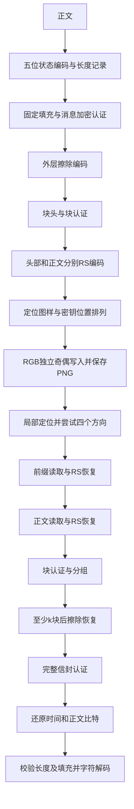

# binary_image_passcode V2.1 开发者 README

文档核对日期：2026-11-04。

本文以 Python 桌面实现 **2.1.0** 为基准，完整说明字符编码、消息封装、图像传输、纠错、密钥存储及工程接口。阅读本文不需要了解其他版本或此前的设计讨论。

文档中的字节偏移从0开始，区间采用 `[起点, 终点)`；整数默认使用大端序，字节内部按最高有效位优先。代码示例均在项目根目录运行。协议细节以 `bip/` 中的实现为准。

## 目录

1. [功能与设计边界](#1-功能与设计边界)
2. [目录与模块职责](#2-目录与模块职责)
3. [环境、运行与命令行](#3-环境运行与命令行)
4. [术语和固定参数](#4-术语和固定参数)
5. [完整字符编码规则](#5-完整字符编码规则)
6. [固定消息封装](#6-固定消息封装)
7. [密钥派生、时间与正文加密](#7-密钥派生时间与正文加密)
8. [外层擦除恢复](#8-外层擦除恢复)
9. [数据块封装与内层纠错](#9-数据块封装与内层纠错)
10. [像素槽位与位置排列](#10-像素槽位与位置排列)
11. [定位、旋转与裁剪恢复](#11-定位旋转与裁剪恢复)
12. [自适应布局与资源限制](#12-自适应布局与资源限制)
13. [加解密完整执行顺序](#13-加解密完整执行顺序)
14. [开发接口与可运行示例](#14-开发接口与可运行示例)
15. [本地密钥库与加密备份](#15-本地密钥库与加密备份)
16. [GUI、异常、取消与文件安全](#16-gui异常取消与文件安全)
17. [测试、复现与构建](#17-测试复现与构建)
18. [安全属性与实际限制](#18-安全属性与实际限制)
19. [兼容、跨语言实现与扩展](#19-兼容跨语言实现与扩展)
20. [参考资料](#20-参考资料)

## 1. 功能与设计边界

程序将文字编码为固定长度二进制正文，通过密钥和消息随机值生成掩码并认证，再把经过纠错保护的数据分散写入图片RGB通道的最低有效位。接收端仅需图片和同一把通信密钥即可恢复消息，不需要原始载体图片、原图尺寸或另行传递位置表。

本版具备以下行为：

- Python GUI支持Windows和Linux；Windows提供独立GUI EXE。
- PNG、JPEG、BMP、静态WebP、TIFF等可作为输入载体，经转换后统一输出PNG。
- 红、绿、蓝三个通道独立承载比特；不进行三通道多数表决。
- 正文固定300,000比特，最多60,000个五位编码单元。
- 支持BMP内所有非代理码点，包括控制字符；不支持补充平面字符。
- 生成时间使用秒级Unix时间，界面显示秒级北京时间，不显示数值时间戳。
- 数据块包含局部定位、内层纠错和认证；外层擦除码支持部分完整块丢失后的恢复。
- 支持128位十进制共享密钥、多密钥库、操作系统保护或主密码保护，以及独立密码加密备份。

PNG像素值保持不变的重新压缩不会改变载荷。平移裁剪和90°倍数无插值旋转可以由当前识别流程处理。JPEG重新压缩、缩放、任意角度旋转、镜像、截图或颜色重映射，不属于本传输配置的可靠恢复范围。

这是一套自定义消息封装和图像传输协议。密钥库使用AES-GCM；**图片正文使用HMAC派生掩码与异或，不使用AES-GCM**。两者不能混为同一种加密封装。

## 2. 目录与模块职责

```text
binary_image_passcode/
├── binary_image_passcode.py       GUI/CLI统一入口
├── bip/
│   ├── __init__.py                应用名称和软件版本
│   ├── codec.py                   字符状态机、五位打包、Unicode转义
│   ├── protocol.py                密钥派生、时间、正文掩码、信封认证
│   ├── erasure.py                 GF(256)矩阵编码和擦除恢复
│   ├── image_transport.py         RGB读写、定位、RS、布局及文件API
│   ├── vault.py                   密钥库、DPAPI/Secret Service、备份
│   ├── gui.py                     Tk界面和后台任务协调
│   ├── errors.py                  异常类型与取消检查
│   └── legacy20/                  隔离的兼容读取实现
├── tests/                        Python自动化测试
├── assets/                       图标及Windows版本资源
├── examples/                     公开测试图片和正文
├── docs/                         用户截图、架构和既有测试报告
├── licenses/                     打包依赖许可文本
├── requirements.txt              运行依赖
├── requirements-dev.txt          测试依赖
├── pyproject.toml                项目元数据和pytest配置
├── build_windows.py              Windows PyInstaller构建
├── run_windows.bat               Windows启动脚本
└── run_linux.sh                  Linux启动脚本
```

已有源码目录还可能包含 `android/`：它是相同图片协议的独立Java前端，非Python桌面程序的运行依赖。其密钥库实现与桌面端不同，见第19节。

分层原则是：字符编码不访问文件和密钥库；消息封装不处理图片；图像层接收显式密钥；GUI不另行实现密码算法。其他前端优先调用公开API，不通过解析GUI文本获取结果。

## 3. 环境、运行与命令行

### 3.1 依赖

项目声明Python **3.11及以上**。当前运行依赖为：

| 依赖 | 项目约束 | 用途 |
| --- | --- | --- |
| Pillow | `>=11,<14` | 图像解码、EXIF方向、RGB转换、PNG保存 |
| NumPy | `>=2,<3` | 位打包、GF矩阵运算、像素索引和积分图 |
| cryptography | `>=43,<51` | HKDF、AES-GCM、Scrypt |
| reedsolo | `==1.7.0` | 内层Reed–Solomon纠错 |
| Tkinter | 随Python/系统安装 | 桌面GUI |
| pytest | `>=8,<10`，开发依赖 | 自动化测试 |

`requirements.txt` 中的范围不是完整锁文件。发布时应记录实际Python和依赖版本；跨语言移植应依赖本文的线格式与测试向量，而不是依赖某个运行库的默认随机数行为。

### 3.2 Windows源码运行

```powershell
python -m venv .venv
.venv\Scripts\python.exe -m pip install -r requirements.txt
.venv\Scripts\python.exe binary_image_passcode.py
```

`run_windows.bat` 优先启动目录中的EXE；调试Python修改时，使用上面的显式Python入口，避免误启动尚未重新构建的EXE。

### 3.3 Linux源码运行

```bash
# Debian/Ubuntu示例；系统包名称随发行版变化。
sudo apt install python3-tk python3-venv libsecret-tools
python3 -m venv .venv
.venv/bin/python -m pip install -r requirements.txt
.venv/bin/python binary_image_passcode.py
```

GUI需要图形桌面和显示服务。`libsecret-tools` 提供 `secret-tool`，仅系统密钥环保护需要它；没有Secret Service的环境可以使用主密码保护。单独使用数组或信封API不需要初始化Tk，也不需要建立密钥库。

### 3.4 CLI

```bash
python binary_image_passcode.py --version
python binary_image_passcode.py gui
python binary_image_passcode.py capacity cover.png --strength balanced
python binary_image_passcode.py encode cover.png --text-file message.txt --output encoded.png --key friend
python binary_image_passcode.py decode encoded.png --output recovered.txt --key friend
```

`--key` 是**密钥库内的名称或ID**，不是原始128位密钥；省略时选默认密钥。`encode`/`decode` 可用 `--vault PATH` 指定库文件。主密码库从终端通过 `getpass` 读取密码；系统保护库通过对应系统后端解锁。CLI没有创建密钥库子命令，首次使用可通过GUI建立。

编码读取UTF-8正文文件，允许UTF-8 BOM，并通过 `newline=''` 保留CR/LF区别。正文文件还有200,000字节的CLI输入限制；编码层自身另有字符数及单元数限制。`decode` 未指定输出路径时把正文写到stdout，生成时间写到stderr。覆盖已有文件必须使用 `--force`。

入口正常完成返回0；运行依赖缺失返回2；通常业务错误返回1；参数解析错误由argparse处理。无控制台Windows EXE面向GUI，CLI使用Python入口。

## 4. 术语和固定参数

| 名称 | 值或含义 |
| --- | --- |
| 通信密钥 `key` | 恰好128个ASCII数字字符，前导零有意义 |
| 编码单元 | 0—31的一个整数，占5比特 |
| `UNIT_COUNT` | 60,000 |
| `BODY_BITS` / `BODY_BYTES` | 300,000 / 37,500 |
| `used_units` | 实际正文编码单元数，1—60,000 |
| 随机值 `nonce` | 每条消息48字节，公开但参与派生 |
| 消息信封 `envelope` | 含头部、加密长度及正文、完整认证的37,595字节 |
| `tile` | 128×128像素的局部承载区域 |
| `shard` | 外层编码得到的一份等长数据块 |
| `packet` | 块头、shard、块认证及内层RS构成的传输数据 |
| `n` | 图片实际写入的块总数，最多196 |
| `k` | 恢复需要的有效块数，至少8 |
| 擦除 | 知道某块不可用或未找到，不把它当可信数据参与恢复 |
| 颜色槽位 | 某像素的一个通道；一个RGB像素有3个槽位 |

软件版本字符串为 `2.1.0`，线格式的 `VERSION=2`、`CODEC_ID=1`、`PROFILE_ID=2` 是三个独立字段，不能直接从软件版本的小数位推导。

## 5. 完整字符编码规则

### 5.1 支持范围与状态

支持Unicode码点 `U+0000—U+FFFF`，但排除 `U+D800—U+DFFF` 代理码点，共63,488个取值。这里的“BMP”指Unicode基本多文种平面，不是BMP图片格式。不做Unicode规范化、简繁转换或换行规范化；组合字符与预组合字符按原输入分别保留。

基础短编码字符共87个：大小写字母52个、数字10个、空格/句号/逗号/反斜杠/竖线5个，以及20个数字模式符号。其余受支持字符通过六单元扩展表示，包括换行、制表符和NUL。补充平面字符即使能由UTF-8表示，也会被本编码拒绝。

编码器维护两个布尔状态：

```text
numeric = False   是否处于数字模式
upper   = False   字母是否按大写读取
```

进入数字模式不会清除 `upper`。离开数字模式后，继续使用此前的字母大小写状态。

### 5.2 完整32项状态表

表中的数字是单元值，不是ASCII码。普通模式由 `numeric=False` 且 `upper=False` 表示；大写模式由 `numeric=False` 且 `upper=True` 表示。

| 十进制 | 五位编码 | 普通模式 | 大写模式 | 数字模式 |
| ---: | --- | --- | --- | --- |
| 0 | `00000` | a | A | 0 |
| 1 | `00001` | b | B | 1 |
| 2 | `00010` | c | C | 2 |
| 3 | `00011` | d | D | 3 |
| 4 | `00100` | e | E | 4 |
| 5 | `00101` | f | F | 5 |
| 6 | `00110` | g | G | 6 |
| 7 | `00111` | h | H | 7 |
| 8 | `01000` | i | I | 8 |
| 9 | `01001` | j | J | 9 |
| 10 | `01010` | k | K | `+` |
| 11 | `01011` | l | L | `-` |
| 12 | `01100` | m | M | `*` |
| 13 | `01101` | n | N | `/` |
| 14 | `01110` | o | O | `=` |
| 15 | `01111` | p | P | `!` |
| 16 | `10000` | q | Q | `%` |
| 17 | `10001` | r | R | `_` |
| 18 | `10010` | s | S | `:` |
| 19 | `10011` | t | T | `;` |
| 20 | `10100` | u；也可能为扩展引导的第二单元 | U | `?` |
| 21 | `10101` | v | V | 半角双引号 `"` |
| 22 | `10110` | w | W | `<` |
| 23 | `10111` | x | X | `>` |
| 24 | `11000` | y | Y | `(` |
| 25 | `11001` | z | Z | `)` |
| 26 | `11010` | 半角逗号 `,` | 半角逗号 `,` | `[` |
| 27 | `11011` | 反斜杠或扩展引导 | 竖线 `|` | `]` |
| 28 | `11100` | 半角空格 | 半角空格 | `{` |
| 29 | `11101` | 半角句号 `.` | 半角句号 `.` | 半角句号 `.` |
| 30 | `11110` | 切换大小写状态 | 切换大小写状态 | `}` |
| 31 | `11111` | 进入数字模式 | 进入数字模式 | 退出数字模式 |

数字模式没有独立的空格编码。编码器遇到空格、逗号、字母、竖线、反斜杠或扩展字符时，先输出31退出数字模式。句号29可在任何状态直接输出，且不会关闭数字模式。30仅在非数字状态切换大小写，**不要求成对紧邻出现**。

数字模式符号顺序是协议的一部分：

```python
NUMBER_SYMBOLS = '+-*/=!%_:;?"<>()[]{}'
SLOTS = [v for v in range(10, 32) if v not in (29, 31)]
```

不采用0—31组合数、十进制两位压缩或数字冗余表示；每个十进制数字在数字模式中对应0—9的一个单元。

### 5.3 编码器的选择规则

按输入字符顺序处理：

1. 句号直接输出29，保持两个状态。
2. 数字或20种数字符号：必要时输出31进入数字模式，然后输出对应值。
3. 其他字符：若正在数字模式，先输出31退出。
4. 空格输出28，逗号输出26；均保持字母大小写状态。
5. 字母：若字符大小写与 `upper` 不一致，先输出30，再输出字母序号0—25。
6. 竖线：确保 `upper=True` 后输出27。
7. 反斜杠和扩展字符：确保 `upper=False`，然后按下一节处理。
8. 正文结束时若仍在数字模式，补31关闭；不强制把大写状态切回小写。

例如：

```text
输入：a A 12.3
单元：[0, 28, 30, 0, 28, 31, 1, 2, 29, 3, 31]
```

### 5.4 六单元Unicode扩展与反斜杠消歧

在非数字、小写状态，连续单元 `[27,20]` 是扩展引导，随后必须是4个取值0—15的单元，依次表示Unicode码点的四个十六进制数字：

```text
[27, 20, 高4位, 次高4位, 次低4位, 低4位]
```

码点的四个数字均作为原始半字节读取，不触发数字或字母状态机；只有0—15合法。解出的字符必须属于受支持范围，且不能是已有基础短编码的字符。

```text
中 = U+4E2D
单元：[27, 20, 4, 14, 2, 13]
比特：11011 10100 00100 01110 00010 01101
```

以上分组空格只为阅读方便，实际正文是连续比特。扩展引导并不包含额外空格，也不是把Python字符串转义写法逐字存入图片。

普通反斜杠本身只需27。歧义来自字面输入的反斜杠后紧跟小写 `u`：它也可能形成 `[27,20]`。为消歧，编码器在该反斜杠后插入两次大小写切换 `[30,30]`；两次切换最终恢复原状态，但打断扩展引导的连续性。

```text
字面输入：\u
编码：[27,30,30,20]
解码：反斜杠 → 切换 → 切回 → 字母u

字面输入：\u1234
编码：[27,30,30,20,31,1,2,3,4,31]
```

因此，只有少数需要消歧的反斜杠序列增加两个单元，其他反斜杠不用统一转义为两个单元。

### 5.5 容量与五位打包

`logical_units(text)` 拒绝空字符串、超过60,000个Python字符的输入、非法码点，以及编码后超过60,000单元的正文。大小写、数字边界等控制单元也计入容量。

例如60,000个小写 `a` 可以编码；60,000个大写 `A` 需要额外的初始大小写切换，因而超限。10,000个连续“中”恰好占60,000单元；混合文本可能因切换开销提前达到上限。

正文实际单元列表以28（空格值）补至60,000项。每项用5位大端比特表示，串联后 `np.packbits(..., bitorder='big')` 得到37,500字节。所有单元总位数可被8整除，无额外尾部位填充。

`used_units` 单独记录真实单元数，解码仅将这些单元送入状态机，并检查剩余单元全为28。因此原始尾部空格、全空格正文、NUL和换行不会通过 `strip()` 等方法被丢弃。

## 6. 固定消息封装

封装格式如下，所有消息总长度固定为 **37,595字节 / 300,760比特**：

| 偏移区间 | 长度 | 字段 | 内容 |
| --- | ---: | --- | --- |
| `[0,4)` | 4 | magic | ASCII `BIP2` |
| `[4,5)` | 1 | version | 2 |
| `[5,6)` | 1 | codec | 1 |
| `[6,7)` | 1 | profile | 2 |
| `[7,8)` | 1 | flags | 0 |
| `[8,56)` | 48 | nonce | 本条消息随机值 |
| `[56,61)` | 5 | encrypted_time | 加密Unix秒数 |
| `[61,63)` | 2 | encrypted_used | 加密后的实际单元数 |
| `[63,37563)` | 37,500 | encrypted_body | 加密后的固定正文 |
| `[37563,37595)` | 32 | tag | 完整HMAC-SHA256 |

头部由Python `struct.Struct('>4sBBBB48s5s')` 定义，共61字节。两字节长度元数据和37,500字节正文合在一起加密，所以用于异或的明文长度为37,502字节。不要把 `[61,63)` 当成可以直接读取的明文长度。

头部包含明文随机值和加密时间，但所有头部字节都受到完整信封认证。随机值不是需要保密的附加私钥。

## 7. 密钥派生、时间与正文加密

### 7.1 通信密钥

`validate_key()` 要求字符串恰好128个字符，且每个字符都在ASCII `0`—`9`。不能先转成整数再转回字符串，否则会丢失前导零；全角数字也不合法。

`generate_key()` 使用 `secrets.choice('0123456789')` 逐位生成。均匀随机的128位十进制字符串具有约 `128×log2(10)≈425.2` 比特的候选空间，但本实现将各用途派生为256位子密钥，不能据此宣称具有425位的实际密码安全强度。手工选择重复数字的密钥也不具备随机生成密钥的熵。

### 7.2 HKDF用途分离

所有子密钥长度为32字节，使用HKDF-SHA256：

```text
IKM  = key.encode('ascii')
salt = nonce                 对消息相关用途
salt = 16个零字节             对不带nonce的用途
info = b'binary_image_passcode/v2.1/' + purpose
L    = 32
```

| purpose的ASCII字节 | salt | 用途 |
| --- | --- | --- |
| `time` | 本消息nonce | 时间偏移 |
| `body` | 本消息nonce | 正文掩码 |
| `authentication` | 本消息nonce | 完整信封认证 |
| `header-positions` | 16个零字节 | 在恢复nonce前读取块头的位置 |
| `body-positions` | 本消息nonce | 各块正文位置排列 |
| `packet-authentication` | 本消息nonce | 数据块认证 |

HKDF是子密钥派生，不是主密码慢速拉伸函数。低熵口令不能仅通过填满128位数字或调用HKDF变成高熵通信密钥。[HKDF定义见RFC 5869](https://www.rfc-editor.org/rfc/rfc5869)。

### 7.3 时间表示与加密

时间起点为UTC 1970-01-01 00:00:00。用整数 `T` 表示经过的秒数，舍去小数秒，合法范围：

```text
0 <= T < 10,000,000,000
```

对应终点UTC 2286-11-20 17:46:39，北京时间2286-11-21 01:46:39。负时间和超出范围的时间报错。未显式传入时间时取当前UTC；传入无时区的Python `datetime` 时，按北京时间解释。

时间数值以10位十进制范围定义，但二进制头部存的是5字节整数，不是10个ASCII数字。该范围需要34比特，40比特容器的高6位必须为0；解析时通过数值范围检查排除非法值。

```text
K_time = derive_key(key, b'time', nonce)
O      = int_be(HMAC_SHA256(K_time, b'seconds')) mod 10^10
E      = (T + O) mod 10^10
```

头部保存 `E.to_bytes(5,'big')`。完整消息认证通过后，再用 `T=(E-O) mod 10^10` 还原。由于偏移同时依赖密钥和nonce，同一时刻的不同消息不会使用固定的时间偏移。设备时钟可被调整；该字段不构成第三方时间证明。

### 7.4 正文掩码

设 `P = uint16_be(used_units) || packed_body`，长度37,502字节。掩码按如下规则生成：

```text
K_body  = derive_key(key, b'body', nonce)
context = b'mask\x00' || uint40_be(T) || nonce
block_i = HMAC_SHA256(K_body, context || uint16_be(i))
mask    = (block_0 || block_1 || ... )[:37502]
C       = P XOR mask
```

计数器从0开始，需要 `ceil(37502/32)=1172` 个HMAC块。输入中的时间是解密后的秒数 `T`，不是头部的加密时间 `E`；计数器是两字节大端，不是ASCII十进制字符串。

掩码的生成是自定义协议构造。默认 `seal()` 使用48字节 `secrets.token_bytes()` 随机值；不要在生产代码中用固定nonce替换它。固定密钥、固定nonce和固定时间会重复掩码。

### 7.5 完整消息认证

```text
K_auth = derive_key(key, b'authentication', nonce)
tag    = HMAC_SHA256(K_auth, header || C)
```

接收端先检查固定长度，解析取得派生所需nonce，然后计算并用 `hmac.compare_digest()` 比较32字节tag。认证成功后才检查格式字段、还原时间、解密正文和执行字符解码。[HMAC机制见RFC 2104](https://www.rfc-editor.org/rfc/rfc2104)。

错误密钥与认证失败使用统一的消息认证错误。格式正确本身不是认证，公开CRC、SHA-256摘要或模校验也不能替代有密钥的认证。

## 8. 外层擦除恢复

### 8.1 为什么需要第二层冗余

图片裁剪可能整块删除数据，也可能切断某块定位标记。此时接收端知道某块缺失，但无法把它交给块内纠错。外层擦除码为这种完整块丢失准备恢复材料。

令信封长度 `L=37595`，实际布局块数为 `n`：

```text
均衡：k = ceil(n/2)
增强：k = ceil(n/3)
s = ceil(L/k)          每个源块字节数
```

信封追加随机字节至 `k*s` 字节，按行分成 `k×s` 源矩阵。追加的是最多 `k-1` 个随机字节，不是字符层的空格填充；恢复后按原长度L截断。

### 8.2 GF(256)与系统生成矩阵

所有矩阵运算在GF(256)中进行，加法为异或，乘法使用本原多项式 `0x11D` 建立的EXP/LOG表。矩阵的整数索引不等于普通实数矩阵运算。

```text
V[i,j] = (i+1)^j       在GF(256)中，i从0到n-1，j从0到k-1
G      = V × inverse(V[:k])
shards = G × source
```

前k行成为单位矩阵，所以前k个shard是源块，其余为线性冗余块。各评价点不同、`n<=196<256`，任取k行可逆。接收端按块序号排序，取k个经过认证的shard，用对应生成矩阵子矩阵的逆恢复源矩阵。

这是GF(256)上的系统Vandermonde擦除码；不能用“把shard串起来”或普通浮点线性求解代替。相关有限域FEC背景可参考[RFC 5510](https://www.rfc-editor.org/rfc/rfc5510)，但本项目的包头与协议字段不等同于该RFC的网络包格式。

### 8.3 信任边界

外层输入只能是**内层纠错后又通过块认证**的数据。未找到、RS失败、字段非法或块认证失败的块均按擦除处理。不要用未认证的损坏块凑够k，否则会把未知错误带入外层恢复。

至少k块有效并不意味着所有可见像素都完好，也不等于剩余面积必须恰好大于 `k/n`；完整块数量才是恢复门限。

## 9. 数据块封装与内层纠错

### 9.1 66字节块头

Python格式为 `struct.Struct('>4sBBBB48sBBBBHI')`：

| 偏移区间 | 长度 | 字段 | 要求 |
| --- | ---: | --- | --- |
| `[0,4)` | 4 | magic | `BIPT` |
| `[4,5)` | 1 | version | 2 |
| `[5,6)` | 1 | profile | 2 |
| `[6,7)` | 1 | codec | 1 |
| `[7,8)` | 1 | flags | 0 |
| `[8,56)` | 48 | nonce | 与信封nonce一致 |
| `[56,57)` | 1 | index | `0<=index<n` |
| `[57,58)` | 1 | k | `8<=k<=n` |
| `[58,59)` | 1 | n | `n<=196` |
| `[59,60)` | 1 | reserved | 0 |
| `[60,62)` | 2 | size | `ceil(37595/k)` |
| `[62,66)` | 4 | total | 37595 |

注意块头的 `profile,codec` 顺序与信封的 `codec,profile` 顺序不同。跨语言实现不能共用一份错误的字段顺序假设。

### 9.2 块认证

```text
K_packet = derive_key(key, b'packet-authentication', nonce)
tag16    = HMAC_SHA256(K_packet, raw_packet_header || shard)[:16]
```

index、k、n、块大小等信息都参与认证。先用头部字段确定有界读取大小，提取对应数据；只有tag验证成功后，才将包纳入消息组。

### 9.3 内层RS

使用 `RSCodec(32)`，对字节进行RS(255,223)编码：每段最多223个原始字节，增加32字节校验；最后一段采用短码。内层库默认参数对应 `prim=0x11D`、`generator=2`、`fcr=0`，移植时须保持一致。

头部与正文分别编码：

```text
prefix       = RS_encode(raw_packet_header)   66+32=98字节
payload      = shard || tag16
coded_body   = RS_encode(payload)
coded_len(m) = m + 32*ceil(m/223)
```

前缀固定784比特。正文编码后比特数为 `8*coded_len(size+16)`。每个内层码字最多纠正16个未知错误字节；一个字节包含多个翻转位仍算一个错误字节。该数值不是“整张图片可容忍16个错误”，也不是可接受任意数量坏块的承诺。

图像识别先于RS解码。若定位标记被破坏至无法识别，不能指望RS替定位器找到该块。Python中的RS实例和相关操作受 `RS_LOCK` 保护，避免第三方库内部有限域状态的并发问题。

## 10. 像素槽位与位置排列

### 10.1 RGB奇偶写入

8位RGB数组中每个通道值为0—255。写入一位 `b`：

```text
new_channel = (old_channel & 254) | b
read_bit    = channel & 1
```

每个被选中的颜色值相对RGB载体最多变化1；R/G/B各传不同的数据，不能对它们进行投票。图像转RGB、透明铺白和EXIF方向校正属于载体预处理，其变化不受“最多1”限制。

局部块内槽位编号：

```text
s       = ((y*128+x)*3)+channel
pixel   = s//3
channel = s%3              0=R，1=G，2=B
x       = pixel%128
y       = pixel//128
```

### 10.2 可用槽位池

一个块有 `128*128*3=49152` 个槽位。三个定位标记各占18×18的R通道区域，含静区，共排除972个槽位。因此：

```text
AVAILABLE数量             48180
前缀位置数量                784
剩余正文候选槽位           47396
```

G/B通道在这些18×18区域中仍可承载独立数据。`AVAILABLE` 按扁平化RGB数组的升序槽位生成。

### 10.3 SHAKE排序排列

位置排列不调用NumPy或语言内置伪随机洗牌，以避免不同语言/库版本产生不同顺序。对给定pool和seed：

```text
stream = SHAKE256(b'BIP/positions/v2.1\x00' || seed)
words  = 从stream取len(pool)*8字节，解释为大端无符号uint64序列
order  = 对words进行稳定升序排序，返回原下标
result = pool[order]
```

遇到相同排序键，保留原pool顺序。必须使用无符号64位比较；Java的有符号long默认排序会使结果与Python不一致。SHAKE256定义见[NIST FIPS 202](https://csrc.nist.gov/pubs/fips/202/final)。

前缀及正文顺序为：

```text
H = permutation(AVAILABLE, derive_key(key, b'header-positions'))
prefix_positions = H[:784]
pool             = H[784:]

K_position = derive_key(key, b'body-positions', nonce)
seed_i     = HMAC_SHA256(K_position, uint8(index))
positions  = permutation(pool, seed_i)[:coded_body_bits]
```

`pool` 是前缀排列剩余部分，**不能重新按槽位数字排序**。前缀布局仅依赖通信密钥，使解码器能在未知nonce时读取块头；正文位置还依赖nonce和index。相同通信密钥下，前缀位置会重复，这也是统计分析时可能利用的结构。

## 11. 定位、旋转与裁剪恢复

### 11.1 局部三点标记

每块三个14×14图样左上角坐标为：

```text
(8,8)、(106,8)、(8,106)
```

图样由以下7×7矩阵在水平、垂直各重复2次得到：

```text
1111111
1000001
1011101
1011101
1011101
1000001
1111111
```

外侧各有2像素静区，静区R通道最低位写0；图样1写奇数、0写偶数。这只是二维码式几何标记，不包含标准QR码编码、格式信息或QR纠错协议。

### 11.2 积分图检测

`locate_tiles()` 只扫描R通道最低位。用分条积分图计算候选14×14窗口与模板的失配数量：

```text
mismatch = 132 - S14 + 2*S10 - 2*S6
```

`S14` 为整窗口1的数量，`S10` 为相对 `(2,2)` 的10×10窗口和，`S6` 为相对 `(4,4)` 的6×6窗口和。132是模板1的总数量。失配数不超过12的位置作为候选标记；候选总数超过6000时拒绝继续识别。

扫描每次处理最多256行候选输出，并多读13行以覆盖窗口边界，避免为数千万像素整图保留大型积分图和失配数组。模板匹配不强制验证外侧静区；静区用于减少周围信号干扰。

三点必须相隔固定的98像素，且由其推导出的128×128区域完全位于当前图片内。只保留部分的块不会进入包解码。

### 11.3 方向和消息分组

当前格式解码器对输入尝试 `np.rot90(rgb, rotation)`，`rotation=0,1,2,3`；数组旋转通常为视图，不复制整张RGB图。局部位提取按需执行。

已认证包按 `(nonce,k,n,size,total)` 分组，同一index只纳入一次，最多允许32个消息组。每轮方向扫描后，优先尝试已有有效块多的组；达到k后恢复信封、验证完整HMAC，并检查信封nonce与块组nonce一致。

返回 `rotation` 为解码器为正确读取而应用的0/90/180/270°方向。它不一定等于外部软件此前对图片执行旋转的同方向角度。

## 12. 自适应布局与资源限制

### 12.1 留白与网格

图片宽高为W、H时：

```text
m  = min(0.12, 0.04 + 0.02*log2(max(1,W*H/1048576)))
mx = ceil(W*m)
my = ceil(H*m)
max_cols = floor((W-2*mx)/128)
max_rows = floor((H-2*my)/128)
```

总像素不超过1Mi像素时留白4%；4Mi像素为8%；16Mi像素及以上为12%。这里Mi表示2的20次方，不能用十进制100万替代而期望边界坐标完全一致。

若最大网格不超过196块，使用全部行列；否则枚举合法列数，对每个候选取可容纳的最大行数，优先最大化块数，再最小化网格长宽比与图片长宽比之比的对数绝对值。

横向坐标用 `linspace(mx,W-mx-128,cols)`，纵向同理，然后 `np.rint()` 取整。只有一列或一行时，位置为起始留白坐标。跨语言生成一致布局时须注意 `rint` 的偶数舍入规则；但解码器不会根据全图布局重算块坐标，所以不同合法布局仍可读取。

### 12.2 合法性检查

| 检查项 | 限制 |
| --- | --- |
| 均衡总面积下限 | 313,600像素，方图参考560×560 |
| 增强总面积下限 | 484,416像素，方图参考696×696 |
| 短边硬下限 | 140像素 |
| 最大总面积 | 80,000,000像素 |
| 最大单边 | 20,000像素 |
| 文件API输入文件上限 | 150MiB |
| 最少恢复块数 | k≥8 |
| 单块槽位容量 | `784+8*coded_len(size+16)<=48180` |

总面积达标不代表任意细长形状都能放下足够完整块。解密裁剪图不重复应用加密侧的最小面积要求，否则会错误拒绝本来可恢复的剩余图。

文件大小与单边限制由文件读取层执行，编码数组还会经过布局检查。当前 `decode_array()` 自身校验RGB形状、dtype和最大总像素，不重复文件大小或单边限制；对外部数组开放服务时，应由调用方增加资源配额。

### 12.3 实际布局例子

以下数值由V2.1 `plan_layout()` 计算：

| 方图尺寸 | 模式 | n | k | shard字节 | 四边留白比例 | 写入槽位比例 |
| --- | --- | ---: | ---: | ---: | ---: | ---: |
| 560×560 | 均衡 | 16 | 8 | 4700 | 4% | 76.73% |
| 696×696 | 增强 | 25 | 9 | 4178 | 4% | 69.11% |
| 1024×1024 | 均衡 | 49 | 25 | 1504 | 4% | 24.47% |
| 1024×1024 | 增强 | 49 | 17 | 2212 | 4% | 34.49% |
| 2048×2048 | 均衡 | 169 | 85 | 443 | 8% | 8.32% |
| 4096×4096 | 均衡 | 196 | 98 | 384 | 12% | 2.13% |

“写入槽位比例”计算为：

```text
packet_bits = 784 + 8*coded_len(size+16)
fraction = n*(packet_bits+972)/(W*H*3)
```

它表示指定了载荷或标记值的通道槽位比例，不是实际发生数值变化的通道比例，也不是被修改像素的比例。若原通道奇偶已匹配，就无需改变该颜色值。

### 12.4 图像预处理和保存

`load_rgb()` 检查文件大小、像素和边长；拒绝多帧输入；执行EXIF方向校正；透明图像铺白底；返回 `uint8`、`H×W×3` 的RGB数组。数组API要求调用者自行提供该格式。

`encode_array()` 创建RGB副本，输入数组不被改写。文件编码要求输出扩展名为 `.png`，禁止与原始载体路径相同；存在的目标默认拒绝覆盖。输出先保存为目标目录的临时PNG，再用原子替换提交，保存失败或取消时清理临时文件。

80MP是接受上限，不是内存占用上限。输入RGB和输出副本各需约 `3*W*H` 字节，加上Pillow解码、转换、预览、临时索引与分条积分图，实际峰值更高。上限图像不保证在任意机器上都有足够内存。

## 13. 加解密完整执行顺序



认证有两个位置：块认证在外层矩阵恢复之前，完整消息认证在正文解密和显示之前。内层RS只负责修复传输错误，不负责证明密钥或数据来源。

解码头部中的nonce、k、n、size在块认证前只能作为经过范围限制的候选字段，不应据此无上限分配内存、自动访问其他文件或输出候选正文。

## 14. 开发接口与可运行示例

### 14.1 字符和信封API

| API | 结果 |
| --- | --- |
| `logical_units(text)` | 实际单元整数列表 |
| `decode_units(values)` | 从单元列表还原字符串 |
| `pack_text(text)` | `(used_units, 37500字节body)` |
| `unpack_text(body,used)` | 检查填充后还原字符串 |
| `generate_key()` / `validate_key(key)` | 生成/校验通信密钥 |
| `seal(text,key,when=None,nonce=None)` | 37,595字节信封 |
| `open_envelope(envelope,key)` | `DecodedMessage` |

`DecodedMessage` 是冻结dataclass，字段为 `text, generated_at, nonce, used_units`；时间是带 `UTC+08:00` 时区的datetime。

`decode_units()` 是低层工具，不检查固定正文长度、补齐区或认证；不要将不可信图片提取结果直接交给它并显示输出。

### 14.2 数组与文件API

```python
encode_array(rgb, text, key, strength='balanced', when=None,
             cancel=None, progress=None)
# 返回 (output_rgb, layout, nonce)

decode_array(rgb, key, cancel=None, progress=None)
# 返回 DecodeResult

encode_file(source, target, text, key, strength='balanced',
            overwrite=False, cancel=None, progress=None)
# 返回 EncodeResult

decode_file(source, key, cancel=None, progress=None)
# 返回 DecodeResult
```

`strength` 仅接受 `'balanced'`、`'strong'`。`cancel` 使用具有 `is_set()` 的事件对象；`progress(fraction,message)` 接受0—1进度与说明文本，回调在调用方工作线程执行，不应直接操作Tk控件。

主要结果结构：

| 结构 | 字段 |
| --- | --- |
| `Layout` | `width,height,margin_x,margin_y,origins,n,k,shard_size,selected_fraction,margin_fraction` |
| `EncodeResult` | `layout,output_path,used_units,message_id` |
| `DecodeResult` | `text,generated_at,message_id,recovered_shards,total_shards,required_shards,corrected_bytes,rotation,used_units,message_format` |

`message_id` 是nonce的十六进制表示，不是密钥、签名或必须唯一的数据库主键。`corrected_bytes` 累计纳入消息组的不同数据块中，前缀和正文的RS纠正字节数。它不统计整张图改变了多少像素。

### 14.3 不依赖GUI的图片往返

```python
from pathlib import Path
from tempfile import TemporaryDirectory
import numpy as np
from PIL import Image
from bip.protocol import generate_key
from bip.image_transport import encode_file, decode_file

with TemporaryDirectory() as directory:
    directory = Path(directory)
    cover = directory / 'cover.png'
    encoded = directory / 'encoded.png'
    cropped = directory / 'cropped.png'
    rgb = np.random.default_rng(42).integers(
        0, 256, (1024, 1024, 3), dtype=np.uint8)
    Image.fromarray(rgb).save(cover)
    key = generate_key()
    text = 'Hello, 中文. 123\n保留末尾空格  '

    written = encode_file(cover, encoded, text, key)
    restored = decode_file(encoded, key)
    assert restored.text == text
    assert written.layout.n == 49
    assert written.layout.k == 25

    with Image.open(encoded) as image:
        image.crop((100, 100, 924, 924)).save(cropped)
    assert decode_file(cropped, key).text == text
```

该裁剪例子是特定1024方图布局下的可复现实例，不代表任意图片裁掉相同面积都能恢复。示例密钥只存在于临时测试进程，不写入真实密钥库。

### 14.4 可复现信封测试向量

下面固定nonce仅用于实现一致性测试。正文UTF-8字符串为单个小写 `a`，通信密钥是公开测试数据：

```python
from datetime import datetime, timezone
import hashlib
from bip.protocol import seal, open_envelope

key = '01234567' * 16
nonce = bytes(range(48))
when = datetime.fromtimestamp(1793701842, timezone.utc)
envelope = seal('a', key, when=when, nonce=nonce)
assert len(envelope) == 37595
assert hashlib.sha256(envelope).hexdigest() == (
    'ff0fcb4e1b05a5ed83cffa798fe19c8cb5ce'
    '0c65627ef9b8bfec122c3a2ba031')
assert open_envelope(envelope, key).text == 'a'
```

对应61字节头部的十六进制（换行仅为排版）：

```text
4249503202010200
000102030405060708090a0b0c0d0e0f101112131415161718191a1b1c1d1e1f
202122232425262728292a2b2c2d2e2f
0163227d46
```

不要将整个PNG字节摘要当成这个向量的延伸：外层随机补齐、PNG压缩库和图像元数据都可能使文件字节不同。跨平台可先比较信封，再比较指定槽位的RGB值以及最终正文。

## 15. 本地密钥库与加密备份

### 15.1 三类秘密分离

1. **通信密钥**：128位数字，双方共享，用于图片消息。
2. **库主密钥**：32字节，保护本地所有通信密钥记录。
3. **主密码/备份密码**：用户输入，分别派生本地库或备份的保护密钥。

不要把通信密钥的128个数字直接当作库AES密钥，也不要把操作系统封装后的主密钥当成跨平台可移植备份。

### 15.2 桌面库路径与记录

默认路径：

```text
Windows: %LOCALAPPDATA%/BinaryImagePasscode/vault.bipvault
Linux:   $XDG_DATA_HOME/binary_image_passcode/vault.bipvault
         未配置XDG时使用~/.local/share/binary_image_passcode/vault.bipvault
```

库内最多256把通信密钥。名称为1—80个可见字符；ID是16随机字节的32位小写十六进制字符串；名称、ID、原始密钥均不能重复。创建日期保存为UTC ISO字符串。默认ID必须指向存在的记录，空库可为None。

解密后的JSON逻辑结构：

```json
{
  "keys": [
    {"id": "32位小写十六进制ID", "name": "friend",
     "key": "128位数字", "created": "UTC ISO时间"}
  ],
  "default": "默认记录ID或null"
}
```

此处为结构示意，不是可直接导入的合法密钥记录。

### 15.3 外部文件与AES-GCM

库文件为JSON容器，元数据包括：

```text
format='BIP-VAULT', version=1, id, mode, protection
nonce, ciphertext
```

整个记录列表、名称、通信密钥、默认ID一起加密。`nonce` 为每次提交重新生成的12字节随机值，`ciphertext` 包含AES-GCM密文及其认证标签。需要二进制的字段用标准Base64保存。

认证附加数据AAD是元数据的规范JSON：`ensure_ascii=False, sort_keys=True, separators=(',',':')`，再编码UTF-8。元数据不加密，但更改后会使认证失败。跨语言读取必须使用完全一致的AAD字节序列，不能依赖各语言JSON默认空格或键顺序。

三种库保护方式：

| mode | 库主密钥来源 | protection字段 |
| --- | --- | --- |
| `windows` | 32随机字节，由当前Windows账户DPAPI封装 | DPAPI密文的Base64 |
| `linux` | 32随机字节，保存于Secret Service | 字符串`secret-service` |
| `password` | Scrypt从主密码与盐派生 | 16字节盐的Base64 |

Linux调用 `secret-tool`，使用属性 `application=binary_image_passcode`、`vault=库ID` 进行存取，单次调用超时30秒；系统密钥环中存储32字节主密钥的十六进制字符串。

主密码使用Scrypt，`N=32768,r=8,p=1,length=32`，UTF-8密码，16字节随机盐；允许12—1024字符。库文件解析上限2,000,000字节。

### 15.4 提交和并发修改

每次修改先验证待存记录，并以新的AES-GCM nonce加密。跨进程使用旁路 `.lock` 文件锁，Windows通过msvcrt、POSIX通过flock。锁保护期间比较当前库文件SHA-256与解锁时记录的revision，发现外部修改则拒绝覆盖，要求重新解锁。

revision摘要用于并发冲突检测，不承担密码学认证。保存采用同目录临时文件、flush、fsync与 `os.replace()`；POSIX临时文件权限为0600。实现未显式对父目录执行fsync，不能把该流程描述为对所有文件系统断电场景的完整持久性保证。

`lock()` 清除对象中主密钥与解密记录的引用；Python运行时无法保证所有字符串和临时内存被安全擦除。`list_keys()` 只返回ID、名称、创建日期、默认状态和12位十六进制指纹；`get(id)` 才返回通信密钥。指纹不是另一把密钥，也不能证明联系人身份。

### 15.5 桌面备份格式

`export_backup(password)` 输出 `BIP-BACKUP`、版本1的JSON。头部包含格式、版本和16字节随机盐；使用与主密码相同的Scrypt参数派生32字节AES-GCM密钥，另生成12字节nonce。备份头部的规范JSON作为AAD，全部密钥记录作为明文载荷。

备份不依赖原操作系统的DPAPI/Secret Service。导入先验证密码与认证，再验证所有记录，之后在内存中合并并一次提交：重复通信密钥跳过，同名不同密钥自动重命名，ID重新生成；超过256把则不提交。空库导入时尽量保留原备份默认密钥的含义。

示例仅建立临时主密码库：

```python
from pathlib import Path
from tempfile import TemporaryDirectory
from bip.vault import KeyVault

with TemporaryDirectory() as directory:
    vault = KeyVault(Path(directory) / 'test.bipvault')
    vault.create(mode='password', password='local test password 123')
    identity = vault.add('friend')
    backup = vault.export_backup('backup test password 456')
    vault.lock()
    vault.unlock('local test password 123')
    assert vault.default_id == identity
    assert vault.import_backup(backup, 'backup test password 456') == 0
    vault.lock()
```

AES-GCM接口及nonce约束参考[cryptography官方文档](https://cryptography.io/en/latest/hazmat/primitives/aead/)。这里描述的是密钥库存储，不是图片正文算法。

## 16. GUI、异常、取消与文件安全

### 16.1 GUI线程

`gui.py` 使用Tk主线程和单个 `ThreadPoolExecutor` 工作线程。耗时图像操作通过工作队列执行；进度信息进入线程安全队列，由主线程约每60ms轮询处理。编辑计数采用约150ms防抖。

启动任务时禁用相关控件；新解密输入或选用密钥改变时清除旧结果，避免把上一条消息当作当前解密结果。关闭窗口会设置取消事件并锁定密钥库。前端扩展应继续保持Tk操作只在主线程执行。

### 16.2 取消语义

`checkpoint(cancel)` 在布局后、各块编码、定位分条、矩阵行处理和文件提交前等位置检查事件，发现设置后抛出 `Cancelled`。取消是合作式的，不会强行中断正在执行的单次Pillow压缩、HMAC调用或系统密钥环子进程；等待时间取决于下一检查点。

调用进度回调抛出的异常也可能终止操作，扩展前端应避免把UI临时状态错误传播为协议错误。

### 16.3 异常分类

| 异常 | 含义与处理 |
| --- | --- |
| `PasscodeError` | 基础业务错误，继承ValueError；可向用户显示说明 |
| `AuthenticationError` | 密钥不匹配、认证数据错误等；不得显示候选正文 |
| `InsufficientBlocksError` | 已有认证通过的当前格式块，但未达到恢复门限 |
| `Cancelled` | 用户取消；与数据损坏区分 |

未找到标记、发现标记但无法验证、找到有效块但块数不足，属于不同失败阶段。错误消息不是严格的密码正确性判定器；损坏可能表现为错误密钥相同的认证失败。

公共文件接口限制覆盖行为。命令行保存正文也禁止覆盖输入图片；文件原子写入并不意味着设备断电、恶意文件系统或任何异常状态下都无条件成功。

## 17. 测试、复现与构建

### 17.1 Python测试

```bash
python -m pip install -r requirements-dev.txt
python -m pytest tests -q
```

默认55项通过，2项高清测试跳过是已有验证基线。启用高清用例：

```bash
# Linux / bash
BIP_RUN_LARGE=1 python -m pytest tests -q
```

```powershell
# PowerShell
$env:BIP_RUN_LARGE='1'
python -m pytest tests -q
```

既有完整基线为57项通过，包含24MP和48MP真实数组嵌入与裁剪。此处记录的是2026-11-03已有报告结果，不意味着读者在其他机器、依赖组合下已自动获得相同验证。

| 测试文件 | 主要关注点 |
| --- | --- |
| `test_codec_protocol.py` | 全BMP非代理码点、边界、尾部空格、认证前置、时间与随机化 |
| `test_erasure_images.py` | 矩阵恢复、布局、RGB独立比特、图像往返、裁剪、旋转、纠错 |
| `test_large_images.py` | 24MP/48MP、留白和裁剪恢复 |
| `test_vault.py` | CRUD、密码、备份、并发、DPAPI和Linux模拟后端 |
| `test_cli.py` | CLI、文本换行、输出与覆盖检查 |
| `test_gui.py` | GUI输入状态、最小像素、容量及结果状态 |

补充真实Tk界面和冻结EXE测试记录见 [docs/TEST_REPORT.md](docs/TEST_REPORT.md)。Windows GUI/DPAPI已有实测；真实Linux桌面Secret Service尚未实测，不能用模拟测试代替实机验证。

### 17.2 测试矩阵应区分的情况

- 字符数、编码单元数、比特数、文件字节数四种容量边界。
- 字面反斜杠加u与Unicode扩展；数字模式中的26/27/28/30不能按普通控制符解释。
- 时间0、2038/2106附近、9,999,999,999终点及范围外输入。
- 单个像素写入101或010，证明RGB通道没有被错误地多数表决。
- RS恢复成功不等于认证成功；篡改校验字段后必须通过块与信封HMAC检查。
- 已认证块不足时返回不足，不能强行输出“尽量恢复”的部分明文。
- 同面积不同长宽比，不同位置的相同面积裁剪。
- 透明底色、调色板图、EXIF方向、PNG无损重压缩及有损转码反例。
- 错误密钥、取消、磁盘失败、并发库修改、临时文件清理与真实输入不被覆盖。

### 17.3 Windows构建

```powershell
python -m pip install pyinstaller
python build_windows.py
# 或选择其他输出目录：
python build_windows.py --dist-dir dist
```

构建参数包括onefile、windowed、应用图标、版本资源及assets；中间文件位于 `.build/`。该脚本仅面向Windows，源码运行和Linux测试无需PyInstaller。

发布检查应包括：版本资源、独立启动、真实加解密、输入不覆盖、错误密钥不产生明文文件、库保护后端、许可文本和包内不含测试私钥/真实库/签名私钥。对最终发布文件计算摘要，而不是只对构建中间产物计算。

## 18. 安全属性与实际限制

### 18.1 各层分别解决什么

| 层 | 目的 | 不能替代的能力 |
| --- | --- | --- |
| 五位字符编码 | 可逆、紧凑地表示字符 | 不提供保密 |
| 掩码及异或 | 将编码数据转换为密文 | 不能单独判断篡改 |
| 完整HMAC | 检查消息与密钥、完整性是否一致 | 不证明现实发送者身份 |
| 块HMAC | 阻止未认证块参与矩阵恢复 | 不修复传输错误 |
| 内层RS | 修复一定数量的字节错误 | 不是有密钥认证 |
| 外层擦除码 | 在足够有效块下恢复丢失部分 | 不能从任意极小裁剪恢复 |
| 像素隐写与位置排列 | 将密文融入图片并安排读取 | 不承诺无法检测 |
| AES-GCM密钥库 | 保护落盘的记录 | 不清除进程内存或剪贴板 |

### 18.2 认证范围

消息认证覆盖封装中的头部与加密正文，块认证覆盖块头与shard。未承载数据的像素没有整图认证；图像元数据也不属于本消息信封。

允许纠错恢复意味着图片局部发生修改后仍可能解密成功。成功验证表示最终恢复的数据符合认证，不表示图片文件逐字节没变，也不表示可见画面真实。

共享密钥的任一持有人都能生成合法消息，不具备数字签名的不可否认性。时间不构成防重放机制；当前实现没有接收历史数据库、去重策略、密钥协商或前向保密。

### 18.3 可检测性与长度

固定正文长度避免在相同承载配置下直接暴露实际使用单元数，但图片尺寸、n/k、定位图样、固定用途的前缀位置、信道比特统计和发送行为仍可能被观察。PNG文件大小还取决于图片内容和压缩结果，不能把固定37,595字节信封理解为固定PNG长度。

128位十进制随机通信密钥与384位公开nonce用途不同。增加公开随机值长度不等于增加秘密密钥强度；知道编码表也不等于知道密钥；算法隐藏不应作为保密性的唯一依据。

项目尚未经过独立密码学审查。使用HKDF、HMAC、AES-GCM等标准原语，不意味着这一自定义组合已经获得标准AEAD协议或隐写不可检测性的安全证明。

## 19. 兼容、跨语言实现与扩展

### 19.1 兼容读取的边界

本README的全部字段和算法定义当前配置。现有 `decode_array()` 会先尝试当前格式；普通当前格式读取失败后，可调用 `legacy20/` 的隔离读取实现。`Cancelled` 和当前格式的 `InsufficientBlocksError` 直接向上抛出，不进入兼容回退。新写出始终使用当前配置。

兼容实现仅用于读取已有图片，不是理解本协议的先决条件，也不应把它的时间、容量或表决规则混入当前格式。前端可用 `DecodeResult.message_format` 决定格式显示。

### 19.2 安卓互通

独立安卓前端复刻相同的字符状态机、信封、HKDF标签、SHAKE排列、RS与外层矩阵，因此可交换当前配置的PNG和128位通信密钥。

安卓本地库由Android Keystore保护，支持200把密钥；其备份使用 `BIPAK1` 二进制格式、PBKDF2-HMAC-SHA256和AES-GCM。桌面库支持256把，备份为 `BIP-BACKUP` JSON与Scrypt。**原始通信密钥和图片可互通，两个备份文件格式不能直接互导。** 安卓的发布版本号与桌面软件版本、线格式版本分别管理。

### 19.3 跨语言移植清单

1. 字符按Unicode码点处理，拒绝代理码点和补充平面字符，不擅自规范化。
2. 状态优先级、数字模式的符号占位、反斜杠消歧、填充值及长度元数据一致。
3. 所有整数大端、比特MSB优先；头部两个格式的字段顺序分别核对。
4. HKDF使用原密钥ASCII字节，salt和info逐字节一致。
5. 时间偏移按256位无符号整数取模，防止使用有符号截断或浮点数。
6. HMAC计数器、index长度、截断方向一致，认证比较不依赖普通早停字符串比较。
7. GF(256)多项式、生成矩阵评价点、系统化方式和RS默认参数一致。
8. SHAKE输出长度正确，uint64无符号稳定排序，pool顺序不变。
9. RGB顺序与ARGB/BGR内存布局区分，保存的是真正RGB像素奇偶。
10. 用固定信封向量、最低尺寸、旋转、裁剪、纠错和错误密钥进行双向验证。

### 19.4 扩展时的协议纪律

改变正文容量、字符状态表、Unicode引导、时间容器、密钥派生域、掩码、认证覆盖或信封长度，应设计新的协议/编码标识。改变标记、槽位、包头或传输编码，应设计新的传输配置标识；不要在既有ID下静默修改。

若更换标准AEAD正文封装，应单独定义nonce、AAD、tag、长度及版本协商规则，保持“验证成功才输出正文”。若增加JPEG或缩放鲁棒性，应新增变换域/信号嵌入层，重新测量容量、视觉变化、误码及恢复边界，而不是仅放宽定位失配阈值。

网络发送、联系人验证、重放防护、密钥轮换、导入外部格式等功能应放在清晰的新边界中；图像解码不应自动执行从图片读取的指令、打开URL或触发外部程序。

## 20. 参考资料

- 项目实现：[字符编码](bip/codec.py)、[消息封装](bip/protocol.py)、[擦除码](bip/erasure.py)、[图像层](bip/image_transport.py)、[密钥库](bip/vault.py)。本文的格式、常数与示例以这些源文件为直接依据。
- [RFC 2104：HMAC](https://www.rfc-editor.org/rfc/rfc2104)。
- [RFC 5869：HKDF](https://www.rfc-editor.org/rfc/rfc5869)。
- [RFC 5510：Reed–Solomon FEC](https://www.rfc-editor.org/rfc/rfc5510)。
- [NIST FIPS 202：SHAKE256](https://csrc.nist.gov/pubs/fips/202/final)。
- [cryptography：认证加密接口](https://cryptography.io/en/latest/hazmat/primitives/aead/)。
- [项目测试报告](docs/TEST_REPORT.md)、[面向用户的使用说明](README.md)。

参考标准描述相应基础原语，不意味着本项目是这些标准定义的完整应用协议，或已通过独立安全认证。
