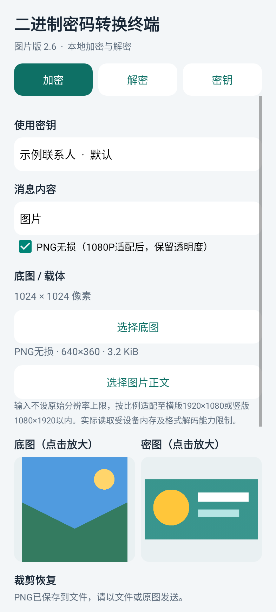
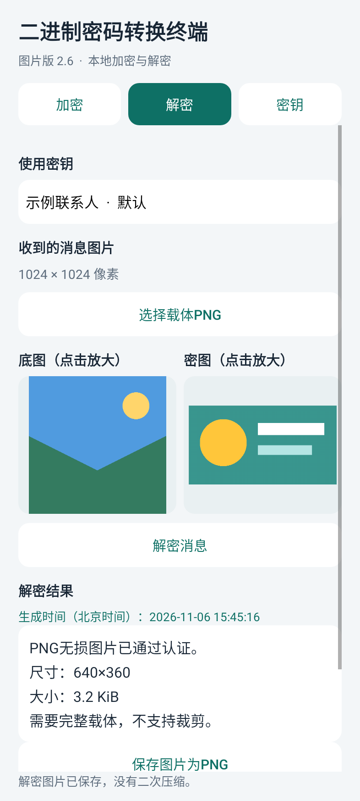

# 二进制密码转换终端 · 图片版 V2.6 安卓版

适用于Android 8.0及以上系统，无需安装Python。支持文字、JPG图片和PNG无损图片消息，可与Windows V2.6交换载体图片。

## 安装与密钥

通过手机文件管理器打开`binary_image_passcode_v2.6.apk`，按系统提示安装。首次安装可能需要为打开APK的应用允许“安装未知应用”。

已有图片终端可直接覆盖升级，本版沿用原包名、签名和密钥库保护方式。建议升级前仍在“密钥”页导出加密备份，妥善保存密码。

在“密钥”生成或导入128位半角数字密钥，给接收者保存同一把密钥。前导零不能删除。支持多密钥、重命名、默认密钥、删除、复制原始密钥及密码加密备份。

## 加密文字

进入“加密”，选择密钥，将“消息内容”设为“文字”，选择底图并输入正文，点击“加密并保存载体PNG”。文字最多60,000编码单元，中文等扩展字符每字占6单元；字符计数单独显示实际数量。原始换行及末尾空格保留。

## 加密图片

1. 将“消息内容”设为“图片”。
2. 选择底图和图片正文。底图是对方直接看到的画面，密图是需要隐藏的内容；两份预览并排显示，点击可放大。
3. 默认使用JPG压缩；需要像素无损时勾选“PNG无损”。
4. 点击加密，优先选择“保存到相册”，也可“保存到文件”。完成后会显示实际秘密图片格式、尺寸及文件大小。

待加密图片不设原始分辨率上限，先等比例适配到横版1920×1080或竖版1080×1920以内，不放大小图。实际读取仍受手机内存、格式解码器和150MiB文件大小限制。

| 模式 | JPG，默认 | PNG无损 |
| --- | --- | --- |
| 容量不足 | 降低质量，必要时继续缩小 | 提示所需空间及建议底图尺寸，不继续缩小 |
| 透明区域 | 白底 | 保留 |
| 裁剪恢复 | 均衡或增强冗余 | 不支持，须完整载体 |
| 解密后保存 | JPG | PNG |

**无损指1080P适配后的8位RGB/RGBA像素，不是原始文件逐字节备份。** 大图的初始缩小会改变像素，不保留源文件全部元数据。范围内无需缩放的8位RGB/RGBA图片可逐像素恢复，包括透明通道。小预览的透明区域显示为白底，保存PNG仍保留透明度。

支持系统可解码的静态PNG、JPG、BMP、WebP等；HEIF等格式取决于系统支持。TIFF等系统不支持的格式，请先转为PNG或JPG。动画请先导出单张静态图片。

## 解密和保存

选择接收者持有的对应密钥及收到的原始载体PNG，点击“解密消息”。程序先验证再显示内容，自动区分文字和图片。

- 文字可复制。
- 图片会与底图并排预览，点击“保存图片为JPG/PNG”另存。
- 保存直接写出已验证的图片数据，不进行二次压缩。
- 生成时间显示为精确到秒的北京时间，不显示数值时间戳。时间取自发送设备的系统时钟。
- 清空结果或选择其他输入、密钥后清除旧密图；已选底图保留。

## 底图大小与传递

文字/JPG模式：均衡至少313,600像素（方图参考560×560），增强至少484,416像素（方图参考696×696），短边至少140像素，长宽比另须满足完整块布局。文字推荐1024方图以上，JPG图片推荐1536或2048方图以上。

PNG无损按实际压缩字节数计算。1024方图约325KiB，2048方图约1.27MiB；复杂1080P RGB图片可考虑4800方图，RGBA图片可考虑5400方图。大底图需要较多手机内存，内存不足时请使用更小的秘密图片或JPG模式。

底图上限8,000万像素、单边20,000、文件150MiB；上限不是所有手机的实际可处理保证。程序不会为解密自动缩放载体。

**外层加密载体始终是PNG，发送时选择文件或原图。** PNG无损正文要求载体像素完整，不支持裁剪或修改；文字/JPG只在保留足够有效块时支持有限裁剪。直角无插值旋转、像素不变的PNG重新压缩可读取。截图、缩放、滤镜和转JPG可能损坏消息。

## 备份与互通

本机密钥名称和密钥一同加密，保护密钥保存在Android Keystore。卸载或清除应用数据会丢失本地密钥，请提前导出加密备份，并单独保管至少12字符的备份密码。

安卓备份用于本图片版安卓应用；Windows备份格式不同。跨平台交换的是128位通信密钥及载体PNG，可手动复制原始密钥导入。V2.6支持原文字图像协议、Windows V2.5 JPG与Windows V2.6 PNG消息；较早接收端不能读取新增的PNG无损正文。

图片和消息均在本机处理，本应用不申请联网或全盘文件管理权限。文件导入与导出使用系统选择器，相册保存按系统版本采用相应授权方式。

## 图片选择、保存与键盘

底图、图片正文和解密载体均提供“从相册选择”和“从文件选择”。相册读取所选图片原始数据，不经过预览重编码。
加密后的PNG与解密后的JPG/PNG均优先提供“保存到相册”，保留“保存到文件”选项。相册保存到 Pictures/BinaryImagePasscode，成功后有提示，不会二次压缩。密文可通过“再次保存密文图片”重新保存。
Android 10及以上保存相册无需申请存储权限；Android 8–9首次保存需授权，拒绝后仍可保存到文件。相册与文件选择器由手机系统提供，外观可能不同。
文字正文、密钥导入和备份密码窗口提供“收起键盘”；单行输入支持键盘完成操作，切换页面或开始处理时自动收起键盘。多行正文保留换行。
